# TP 7 : Système distribué asynchrone JMS avec ActiveMQ

**Étudiant :** [Nom Prénom] · **Groupe :** LSI 3 · **Matière :** Développement d'applications réparties

## Objectif
Mettre en œuvre une communication client/serveur asynchrone avec JMS : un broker ActiveMQ, un producteur (`JMSProducer`) et un consommateur (`JMSConsumer`) qui échangent des messages via un **Topic** nommé `DTopic`.

## Environnement
- JDK 25.0.2
- IntelliJ IDEA
- Maven (projet `tp7_app_reparti`)
- ActiveMQ 6.4.0 (broker, console web sur `http://127.0.0.1:8161/admin/`)
- Bibliothèques Maven : `activemq-client 5.19.1`, `activemq-broker 5.19.1`, `slf4j-simple 2.0.9`

## Structure du projet
```
tp7_app_reparti
├── pom.xml
├── README.md
├── captures/
└── src/main/java/jms
    ├── EmbededActiveMQ.java   Broker ActiveMQ embarqué (BrokerService, TCP 61616)
    ├── JMSProducer.java       Producteur : publie "Hello World! From: [Nom]" sur DTopic
    └── JMSConsumer.java       Consommateur : reçoit les messages avec un MessageListener
```

## Étape 2 : Configuration du projet JMS

### Dépendances Maven (`pom.xml`)
Les dépendances ActiveMQ sont ajoutées au `pom.xml` : Maven télécharge automatiquement les JAR et les ajoute au Build Path.

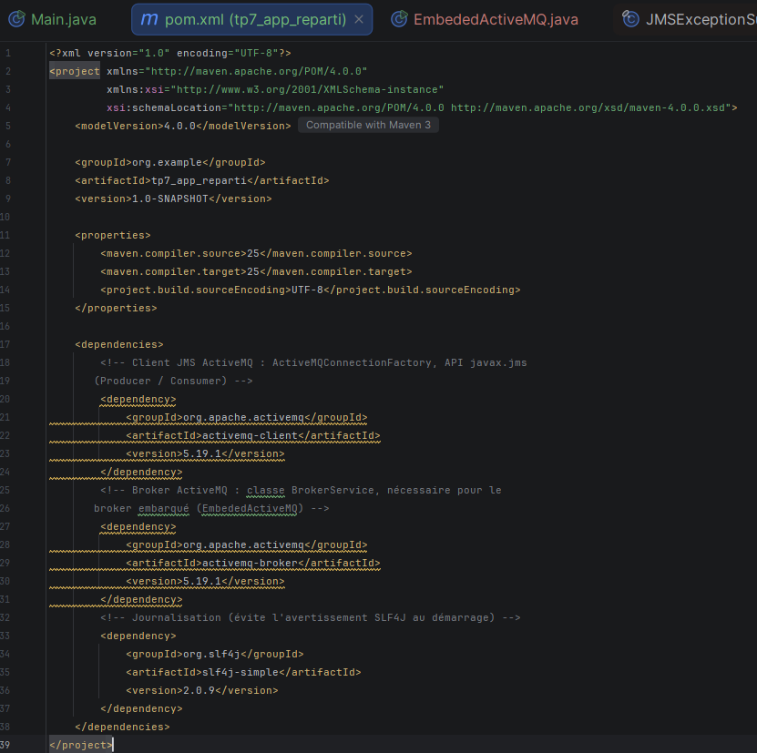

### Broker embarqué (`EmbededActiveMQ`)
La classe crée un `BrokerService`, ajoute un connecteur TCP sur toutes les interfaces (`0.0.0.0`) au port **61616**, puis démarre le broker avec `start()`. Le broker est non persistant (`setPersistent(false)`).

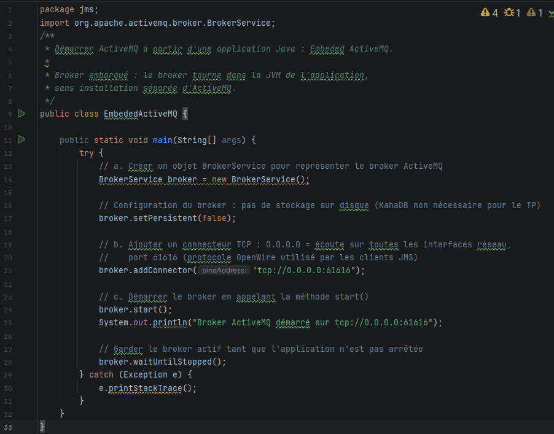

## Étape 3 : Producteur JMS (`JMSProducer`)
Le producteur :
1. crée une `ActiveMQConnectionFactory` avec l'URL `tcp://localhost:61616` ;
2. crée et démarre une `Connection` ;
3. crée une `Session` **transactionnelle** (`true`) avec l'accusé de réception `AUTO_ACKNOWLEDGE` ;
4. crée le `Topic` `DTopic` et un `MessageProducer` en mode **non persistant** (`NON_PERSISTENT`) ;
5. envoie le `TextMessage` « Hello World! From: [NomDeLExpéditeur] » ;
6. appelle `session.commit()` (obligatoire en session transactionnelle), puis ferme la session et la connexion.

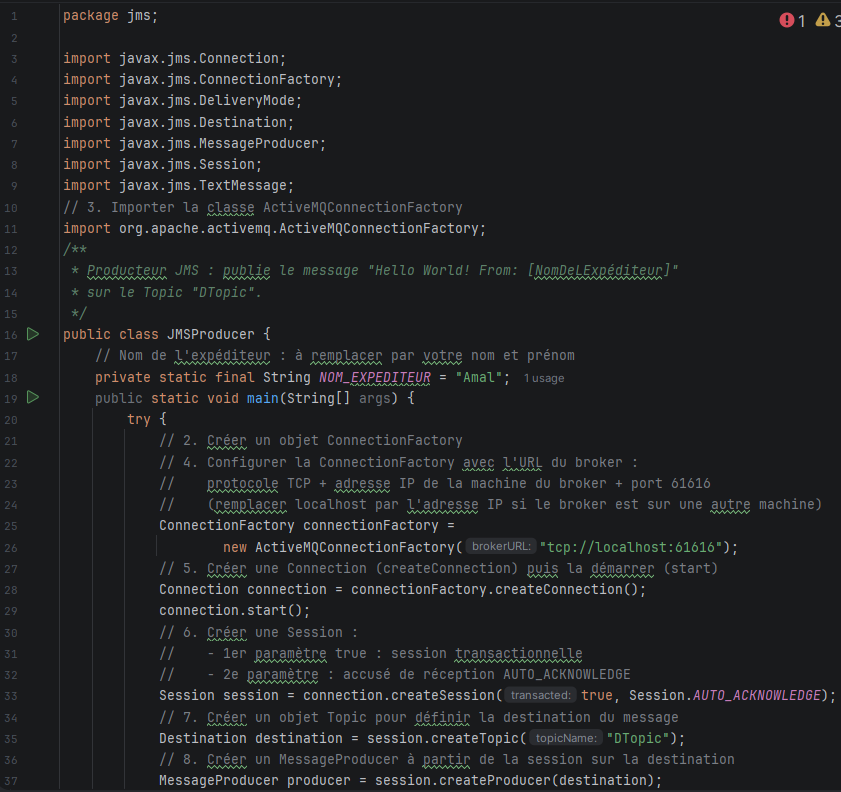
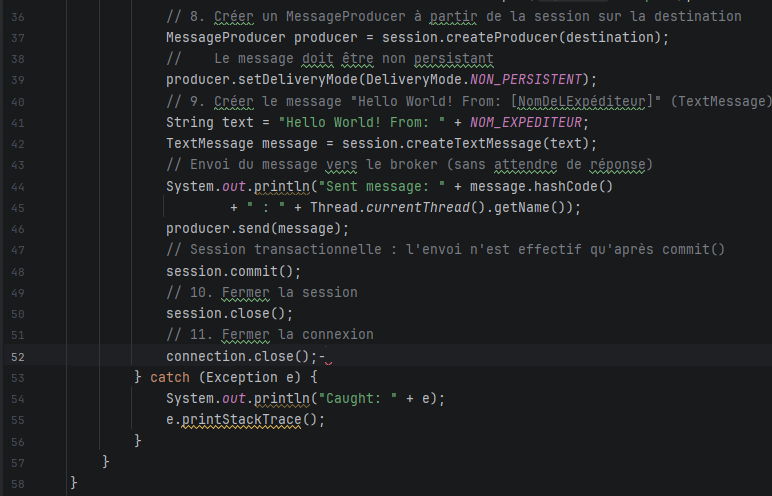

## Étape 4 : Consommateur JMS (`JMSConsumer`)
Le consommateur :
1. crée une `ConnectionFactory` (`tcp://localhost:61616`), une `Connection` et une `Session` non transactionnelle ;
2. crée le même `Topic` `DTopic` et un `MessageConsumer` ;
3. démarre la connexion avec `connection.start()` ;
4. enregistre un **`MessageListener`** : la méthode `onMessage()` est appelée automatiquement à chaque message reçu (réception asynchrone).

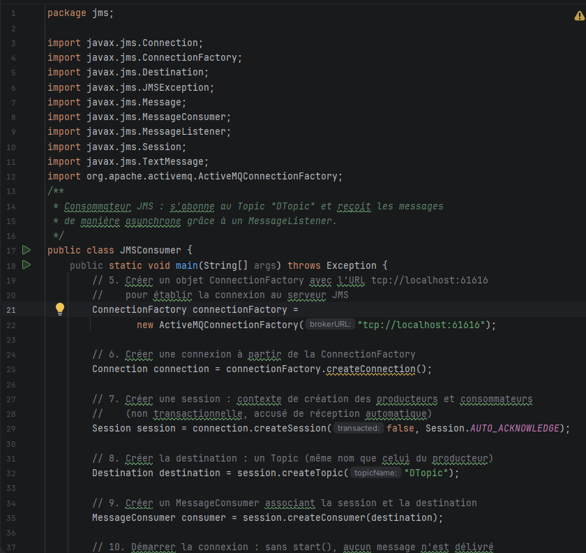
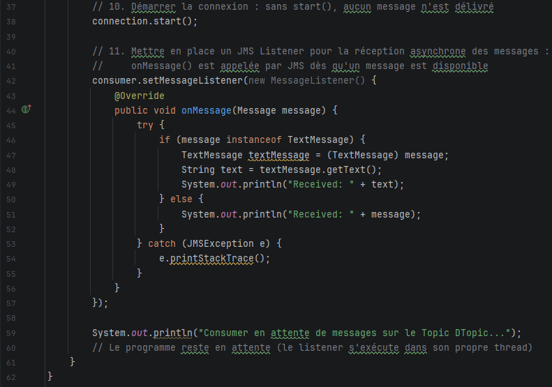

## Étape 5 : Exécution de l'application

### 1. Démarrage du broker ActiveMQ
```
cd Tools\apache-activemq-6.4.0\bin
.\activemq start
```

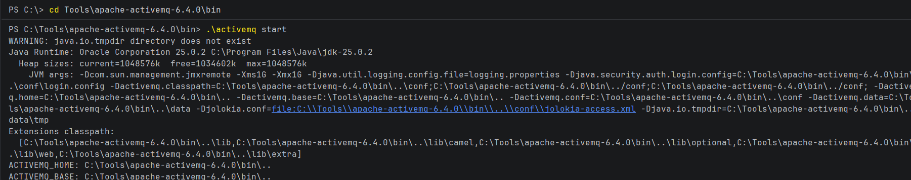

La console web d'ActiveMQ est accessible (broker `localhost`, version 6.4.0).

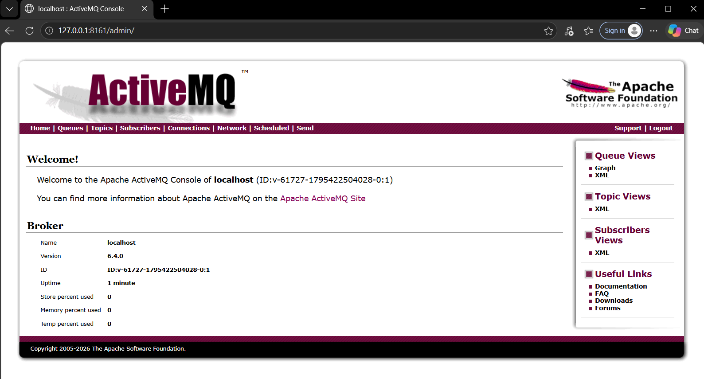

### 2. Lancement du consommateur
`JMSConsumer` est lancé en premier : il attend les messages sur le topic `DTopic`.

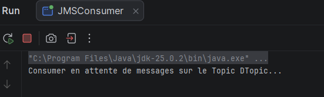

Dans la console web, la page **Topics** montre le topic `DTopic` avec **1 consommateur** connecté.

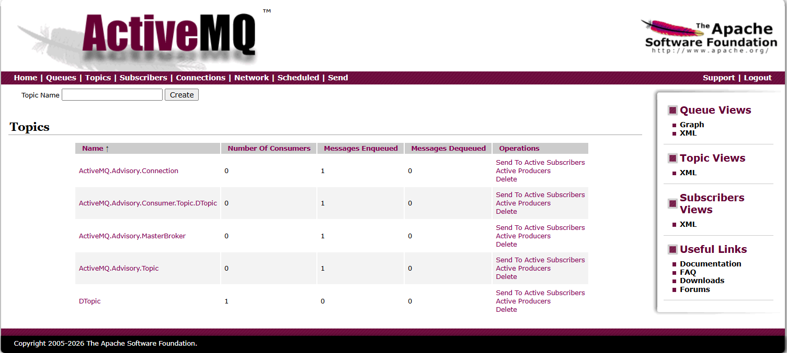

La page **Send** de la console permet aussi de publier un message JMS sur une destination (Queue ou Topic).

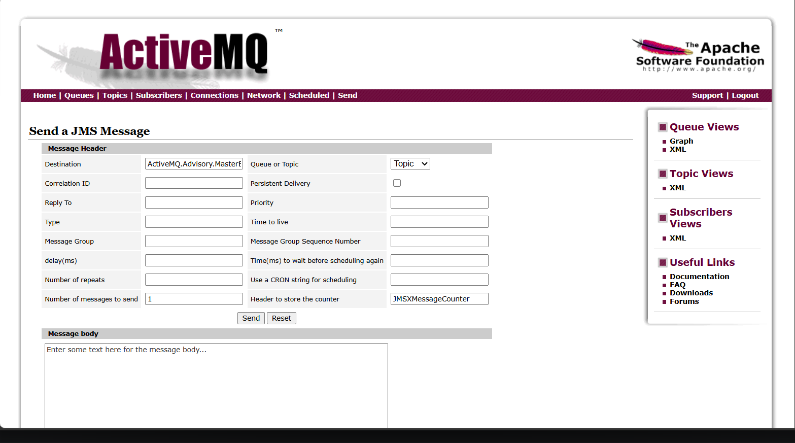

### 3. Lancement du producteur
`JMSProducer` est lancé ensuite : il envoie le message « Hello World! From: [Nom] » puis se ferme.

> À compléter avec votre capture : ``

### 4. Réception du message
Le consommateur affiche le message reçu grâce au `MessageListener`.

> À compléter avec votre capture : ``

## Synthèse
- **JMS** (Java Message Service) est l'API Java standard d'un intergiciel orienté messages (MOM). **ActiveMQ** en est une implémentation : le *broker* reçoit les messages des producteurs et les distribue aux consommateurs.
- La communication est **asynchrone** et **découplée** : le producteur et le consommateur ne se connaissent pas, ils partagent seulement le broker et le nom de la destination (`DTopic`).
- J'ai utilisé un **Topic** (publication/abonnement) : chaque abonné actif reçoit chaque message. Avec une **Queue**, un seul consommateur recevrait chaque message.
- Le consommateur doit être lancé **avant** le producteur : un abonné à un Topic ne reçoit que les messages publiés après son abonnement. La console web le confirme (1 consommateur sur `DTopic`).
- Le producteur utilise une session **transactionnelle** : le message n'est envoyé qu'au `session.commit()`. Le mode **non persistant** signifie que le message n'est pas conservé si le broker s'arrête.
- Le consommateur utilise un **`MessageListener`** : `onMessage()` est appelée automatiquement, sans boucle d'attente. La connexion doit être démarrée (`connection.start()`), sinon aucun message n'est délivré.
- Le broker peut être lancé de deux façons : en **standalone** (`activemq start`) ou **embarqué** dans une application Java (`EmbededActiveMQ`). Les deux utilisent le port 61616, donc un seul des deux doit tourner à la fois.
